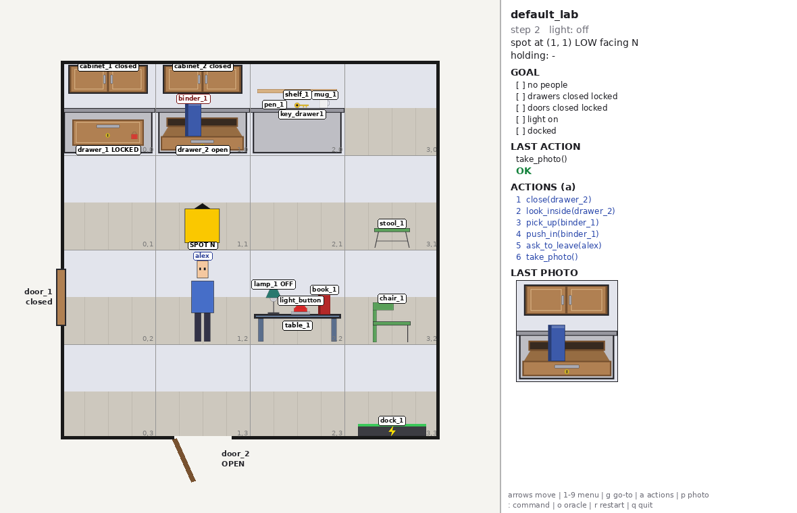

# gridlab

A small grid world modelling the Spot "close down the lab" experiment, so a DIARC planner can be
evaluated on many, harder variants of the task without running the real robot.

* 4 x 4 lab with a LOW and a HIGH level per cell (counters and drawers below, wall cabinets above)
* drawers, cabinets and doors that open, close and lock; keys you insert, turn and remove
* a light that stays on only while its button is held down (by something heavy enough)
* people who have to be asked to leave; a stool to climb; obstructions; a charging dock
* `take_photo`: a picture of the cell in front of the robot, as the gripper camera would see it
* TCP server in the gym-novel-gridworlds2 style for the DIARC agent, with run logs and metrics
* seeded random labs at 5 difficulty levels, all checked solvable by a scripted oracle
* a pygame window to watch the agent, or to play the task yourself with the keyboard



## Install

```bash
pip install -e .[dev]        # Python 3.10+; pygame, Pillow, PyYAML
python -m pytest -q
```

## Use

```bash
python -m gridlab.play                                   # play the default lab with the keyboard
python -m gridlab.play --seed 3 --difficulty 3           # ... or a random one
python -m gridlab.server --port 9000 --view              # let DIARC connect; watch it live
python -m gridlab.server --random 20 --difficulty 0,2,4  # an evaluation run of 60 episodes
python -m gridlab.client --port 9000                     # type protocol commands by hand
python -m gridlab.scenarios generate --seed 7 --difficulty 3 -o lab.yaml
```

Keyboard: arrows move/turn, `1-9` run a menu action, `g` go-to menu, `a` action menu, `p` photo,
`:` or Enter type any command (e.g. `put_on book_1 light_button`), `o` watch the oracle solve it,
`r` restart, `q` quit.

## Documentation

* [docs/protocol.md](docs/protocol.md): the socket protocol: commands, replies, queries, every action,
  failure codes, events, photos, episodes, logs, server options
* [docs/world.md](docs/world.md): the rules of the world (reach, climbing, locks, obstructions, light,
  people, goal)
* [docs/scenarios.md](docs/scenarios.md): the YAML scenario format, object types, random labs and difficulty
* [docs/extending.md](docs/extending.md): adding object types, actions, person behaviours, sprites, goals

## Layout

```
gridlab/core/        world, robot, entities, actions, observations
gridlab/objects/     furniture, items, drawers/cabinets, doors, locks, light, dock, people
gridlab/agents/      person behaviour policies
gridlab/tasks/       close-the-lab goal, oracle solver
gridlab/scenarios/   YAML loader, default_lab.yaml, random generator, CLI
gridlab/render/      sprites (assets/*.png), scene renderer, window panel
gridlab/server/      TCP server, episodes, logging
gridlab/play.py      keyboard game        gridlab/client.py   test client
```
